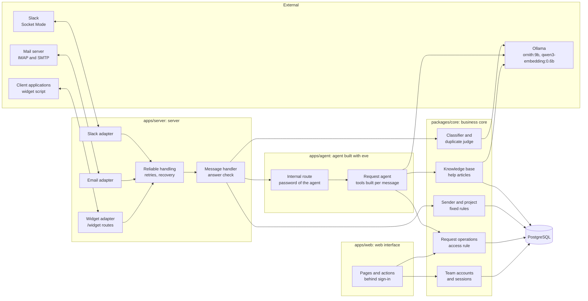
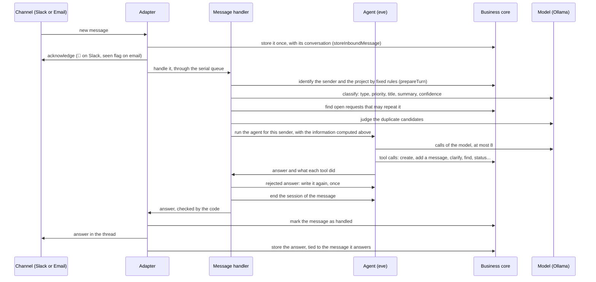

# Architecture

The system receives messages from Slack, from a mailbox and from a web widget, turns them into structured requests with an agent built with [eve](https://github.com/vercel/eve), and lets the team consult and validate them in a web interface. This page describes its parts, the path of a message, and how to add a channel. The reasons behind each choice are in [`decisions/`](decisions/).

## Parts

| Package         | Role                                                                                                                                                                       | Depends on                 |
| --------------- | -------------------------------------------------------------------------------------------------------------------------------------------------------------------------- | -------------------------- |
| `packages/core` | Data model, migrations, request operations and the access rule, classification and duplicate calls to Ollama, knowledge base, team accounts. Knows no channel and no agent | PostgreSQL, Ollama         |
| `apps/server`   | Server: the Slack, Email and widget adapters, the classification, the check of the answers, the retries and the recovery of unhandled messages                             | `packages/core`, the agent |
| `apps/agent`    | Agent built with eve, in its own process: its instructions, its tools and the internal route the server calls with the password of the agent                               | `packages/core`, Ollama    |
| `apps/web`      | Web interface of the team: pages rendered on the server, sign-in, review actions                                                                                           | `packages/core`            |

Dependencies only point to the business core: the adapters, the agent and the web interface can change without touching it, and the core is tested alone against a real database. The server and the agent are two processes: eve runs an agent as its own server, and the server reaches it over HTTP, on the internal network only ([decision 012](decisions/012-eve-agent.md)). What they send each other is defined once, in `packages/core/src/agent/protocol.ts`, and checked on both sides.

## Path of a message

1. **Storing.** The adapter stores the message before anything else, with its original payload, so it is never lost and can always be traced back to its source. A message already stored, such as an event Slack sends twice, is ignored.
2. **Trust.** The adapter tells whether the channel verified the sender: Socket Mode for Slack, a DMARC result from the receiving mail server for email. The model never decides it.
3. **Fixed rules.** The sender is matched to a contact, and the project is found, in this order, from a channel dedicated to a project, a project key in the message, or the only project of the sender. Several possible projects make it ambiguous, and the agent may not pick one.
4. **Classification.** A separate call to the model gives the type, priority, title and summary, with a confidence read from its token probabilities. Thanks and advertisements stop here.
5. **Duplicates.** Open requests of the same project that share words or spelling with the message are given to the model, which names the one about the same problem, or none.
6. **Agent.** The server sends the message to the agent, wrapped as untrusted text, with the information computed above and the verified sender. The agent builds its tools for this sender only, acts on the message, looks up what the answer needs, and writes the answer, in 8 steps at most and within a time limit ([limits of a run](agent.md#limits-of-a-run)). It returns its answer and what each tool did.
7. **Answer.** The server checks the answer of the agent before it is sent. A rejected answer is written again once, in the same session of the agent, with the reasons. When no answer passes the check, the server writes it from what the tools did ([decision 009](decisions/009-agent-answers.md)). Then it ends the session of the message, and eve deletes what it stored about it.
8. **Safety net.** A message the agent left unhandled is filed for a person. A failure is retried after 1 and 5 minutes, then filed for a person. At startup, each adapter handles again the messages stored but not handled.

The steps 3 to 7 are detailed in [`agent.md`](agent.md), the protections in [decision 003](decisions/003-agent-tools-security.md), and the duplicates and retries in [decision 007](decisions/007-duplicates-and-reliability.md).

## Data

Every request keeps its provenance and its full history: the messages it comes from, on which channel and from whom, its classification with the model and its confidence, and every change, made by the agent, the system or a named person. The history can only grow: the database refuses to change or delete an event. The tables are described in [`data-model.md`](data-model.md).

The programs connect with two restricted database roles, never as the owner. The web interface uses `request_agent_app`: it reads, adds and updates rows, and deletes only the links between projects, people and channels, which the administration pages remove. The server and the agent, which read messages written outside the company, use `request_agent_server`: it gets only the tables and columns their work needs, and nothing on the accounts of the team. Neither can change the schema or rewrite the history. Only the owner, used by the migrations and the maintenance commands, deletes the rest.

## Observability

- **History of each request:** every decision of the agent is an event with its details, such as the classification, the model, the version of its instructions, the confidence and the reasons of a review. The web interface shows it.
- **Logs:** the server writes one line per event on its standard output: the connection of each adapter, every failure with its message, and each run of the agent that a limit cut. Tool inputs and message texts are not logged. The agent writes the failures of its tools on its own output.
- **Measures:** `pnpm eval:classification` and `pnpm eval:duplicates` measure the model on labeled messages, so a change of model or instructions can be compared. `pnpm eval:agent` measures the agent with the real model and computes its limits.

## Adding a channel

A new channel, such as Microsoft Teams, is a new adapter in `apps/server`. The agent, the tools and the business core do not change. The adapter must:

1. Add the channel to the `channel` enumeration in `packages/core/src/db/schema.ts`, and generate the migration with `pnpm db:generate`.
2. Store each message received with `storeInboundMessage`, giving its conversation (thread) and its unique external ID, so a message delivered twice is stored once.
3. Decide whether the channel verified the sender, from what the channel itself proves, never from the content of the message.
4. Handle each stored message through `handleReliably` with the shared `handle` of `createChannelHandler`, one message at a time, so a failure is retried and then filed for a person.
5. Send the answer, then store it with `storeOutboundMessage`, with `inReplyTo` set to the external ID of the message it answers.
6. At startup, handle again the messages returned by `listUnhandledMessages` for the channel.
7. Start in `apps/server/src/main.ts` only when its configuration is present, like Slack and Email.

The Slack adapter (`apps/server/src/slack/`), the Email adapter (`apps/server/src/email/`) and the web widget (`apps/server/src/widget/`, [decision 011](decisions/011-web-widget.md)) follow these steps, and their tests show how to test an adapter with a fake channel. The widget was added this way, without changing the agent: its answer is stored in the conversation, which the browser reads.
